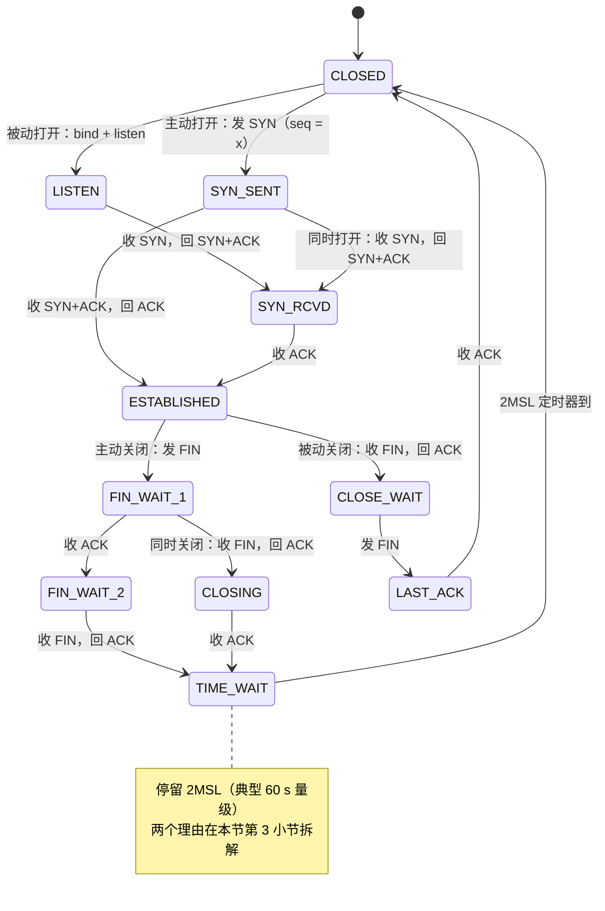

# TCP 与 UDP

01 篇《网络分层模型》在封装瀑布里给传输层留了两个位置：TCP 头与 UDP 头在 IP 头之上二选一，16 位端口对负责把主机间的字节流分发给主机内的进程——发送端多进程共用一个 IP 地址向下复用，接收端按端口对向上分发， $2^{16} = 65536$ 个端口号即复用容量。02 篇《IP 与路由》把分组送到了目的主机的门口：分组在沿途路由器逐跳查表转发，帧头每跳重写而 IP 头端到端不变，但 IP 层对送达只承诺尽力而为（best effort），丢包、乱序、重复可能在任何一跳发生。02-操作系统篇的进程模型补上最后一环：进程借小整数文件描述符（fd）索引内核对象，内核为每条 socket 连接维护发送与接收两个缓冲区，应用 write 把数据拷入发送缓冲即返回，后续的送达全部由内核协议栈接力完成。本篇回答一个问题：在这条不可靠的分组通道上，端到端可靠性从哪来、代价是什么。答案分三段：UDP 把可靠性责任整体转移给应用（第一节），TCP 用两端各自推进的状态栈建立连接语义（第二节），可靠性的四件套——序号、确认与重传、流控、拥塞控制——各付各的税（第三节）。产出的结论由 05 篇 HTTP（请求-响应语义落在哪条传输通道上）与 07 篇 Socket（编程接口映射到哪些状态）消费。

## 一、UDP：最小多路复用与责任转移

用户数据报协议（User Datagram Protocol，UDP）是传输层的最小实现：只保留端口解复用与校验和两件事，其余全部不做。它不是"少做了的 TCP"，而是"只做分发的独立协议"——看清它省下什么、省下的成本转移到谁手里，才知道它该用在哪。

### 1. 8 B 头位标尺：复用与校验的最小集合

```text
UDP 头位标尺（固定 8 B，两个 32 位字，多字节字段按网络序上线）

 位号      31·······························································0
 第 0 字  ┌─────────────────────┬─────────────────────┐
          │ 源端口 [31:16]      │ 目的端口 [15:0]     │ 端口对：解复用的键
 第 1 字  ├─────────────────────┼─────────────────────┤
          │ 长度 [31:16]        │ 校验和 [15:0]       │ 长度连自身 8 B 计入
          └─────────────────────┴─────────────────────┘
            除此之外什么都没有：无序号、无确认、无窗口、无标志位
```

四个字段逐格走一遍。端口对 [31:0] 与 TCP 完全同一套：01 篇已确立端口对是传输层解复用的键，UDP 沿用它，因此同一个进程可以同时开着 TCP 与 UDP 的同一端口号而互不冲突——解复用按"协议号 + 端口"联合查表，IP 头协议号字段（17 为 UDP、6 为 TCP）先把载荷分给协议，再由端口对分给进程。长度 [31:16] 计入自身 8 B，所以最小值是 8（空数据报），字段存在的唯一意义是让接收端知道载荷到哪结束。校验和 [15:0] 沿用 TCP 的伪首部配方——把 IP 头里的源/目的地址借来与 UDP 头、载荷一并计算，端到端数据完整性的锚点；IPv4 下可写 0 表示不校验，IPv6 起强制计算。

8 B 就是 UDP 的全部状态：没有连接，没有序号坐标系，没有确认，没有窗口。收到即按端口上交，发完即忘。这份"没有"就是它的成本转移清单。

### 2. 责任转移账本：省下什么、谁在付

UDP 的每一项"不做"都是一次明确的成本转移。逐项对账：

| 职责 | TCP 的动作 | UDP 的动作 | 成本转移方向 |
| --- | --- | --- | --- |
| 连接建立 | 三次握手加一次往返建状态栈，断连四次挥手再加 TIME_WAIT 停留 | 无状态，首个分组即数据 | 握手往返与时延由无需连接的应用省下 |
| 可靠交付 | 序号 + 确认 + 超时重传，丢失自动补齐 | 不保证送达，丢了就丢了 | 重传责任转移给应用 |
| 有序交付 | 接收端按序号排序去重，上交完整字节流 | 到达即上交，可乱序可重复 | 排序去重责任转移给应用 |
| 流量调节 | 滑动窗口按接收缓冲余量限速发送 | 不限速，接收缓冲装不下即丢 | 过载防护责任转移给应用 |
| 每包头部开销 | 20 B 起，另有确认报文的流量与处理 | 8 B，无确认流量 | 带宽与处理税由高频小包应用省下 |

方向上值得强调的是最后一行的反面：UDP 省下的确认流量不是白省的——它把"网络丢了不知道"变成常态，应用要么容忍丢失、要么自己补。TCP 把重传、排序、流控全部收进内核，代价是每个连接的状态内存、每次交付的确认往返；UDP 把这些开销整体让渡，省下的部分由不需要它们的应用独享。这不是"不可靠也行"的妥协，而是一次精确的分工。

### 3. 正确场景：应用比内核更懂它的数据

UDP 的正确场景是"应用自己能比内核传输层更好地管可靠性"。三类典型消费者：

| 应用 | 它自己管的可靠性动作 | 为什么内核重传反而有害 |
| --- | --- | --- |
| DNS 查询 | 应用层设短超时，超时后重发查询或换服务器再问 | 一次查询一个往返即可完成，先握手再查询平白多两次往返 |
| 实时音视频 | 前向纠错补块、迟到帧直接丢弃不播放 | 播放时刻一过，重传帧到得再准也已作废，重传只会挤占带宽 |
| QUIC（RFC 9000） | 在 UDP 之上用用户态协议栈自建序号、确认、流控与加密握手 | 把可靠性从内核搬到用户态，绕开内核版本迭代周期，协议可随应用快速演进 |

QUIC 是责任转移逻辑的极致样本：它选 UDP 不是要"不可靠"，而是把 TCP 的四件套在用户态重写一遍并加上自己的改进——05 篇 HTTP/3 与 06 篇 TLS 1.3 的握手整合正是消费这份重建。反过来，凡是"少一个字节都不可接受、且应用不想自己管"的数据，就该交给把责任全部收进内核的那一方：传输控制协议（Transmission Control Protocol，TCP）。TCP 的第一步不是发数据，而是用状态机定义"连接"这件事本身。

## 二、TCP 状态机：连接是两端各自推进的状态栈

TCP 的连接不是一条电路，也没有任何中间设备记得它——它就是通信两端各自维护的一栈状态：一端从"关闭"推进到"已建立"再到"关闭"，另一端独立推进自己的同一套状态，双方的报文交换驱动这些状态按固定规则迁移。02-操作系统篇的 socket 对象把这栈状态具象化：每条连接在内核里就是一对缓冲区加一份状态（当前处于哪个状态、序号走到哪、窗口多大）。先上状态机全图，再逐边遍历，最后把建连与断连的两个关键设计单独拆开辩护。

### 1. 有限状态机主干：逐边遍历

状态分支横跨打开、数据、关闭三条路线，ASCII 已超出可读上限，用 mermaid 呈现主干：



沿图逐边遍历，每条边记三件事：谁主动、发什么标志、状态落哪。打开组有两条入口：服务端进程先 bind 再 listen 进入 LISTEN 等客；客户端进程发 SYN（携带初始序号）进入 SYN_SENT，此后一条边直达 ESTABLISHED。服务端从 LISTEN 收到 SYN 后回 SYN+ACK 进入 SYN_RCVD，等到第三次握手的 ACK 才落进 ESTABLISHED——为什么这条边必须等第三次 ACK，下一小节用排除法拆。SYN_SENT 到 SYN_RCVD 的边只在两端同时发起连接时出现，属罕见分支，主干忽略不影响读图。数据组只有 ESTABLISHED 一个状态，全双工收发都在这里发生；第三节四件套的全部机制都挂在这个状态上。关闭组同样两条入口：主动关闭方发 FIN 进入 FIN_WAIT_1，等对方的 ACK 落到 FIN_WAIT_2，再等对方的 FIN、回最后一个 ACK 后进入 TIME_WAIT，定时器走完才回 CLOSED；被动关闭方先收 FIN 回 ACK 进入 CLOSE_WAIT，自己数据发完后才发 FIN 进入 LAST_ACK，收到对方的 ACK 直接 CLOSED。FIN_WAIT_1 到 CLOSING 的边处理两端同时关闭的罕见情形，殊途同归于 TIME_WAIT。图上每个状态都被边穿过，没有孤立节点；两条悬线——第三次 ACK 为什么必须有、TIME_WAIT 为什么必须等 2MSL——分别在下面两小节收口。

### 2. 三次握手：两次不够的排除法

```text
三次握手（左客户端，右服务端；每条箭头标注标志位、序号坐标与两端状态迁移）

 客户端                                        服务端
 CLOSED                                       LISTEN
    │                                             │
    │ ① SYN（seq = x，SYN 本身耗 1 个序号）        │
    ├────────────────────────────────────────────►│
    │                                             │
 SYN_SENT                                     SYN_RCVD
    │                                             │
    │ ② SYN + ACK（seq = y，ack = x + 1）         │
    │◄────────────────────────────────────────────┤
    │                                             │
    │ ③ ACK（ack = y + 1，可捎带应用数据）          │
    ├────────────────────────────────────────────►│
    │                                             │
 ESTABLISHED                                 ESTABLISHED
```

三条边自上而下走完。边①：客户端随机选初始序号（Initial Sequence Number，ISN） $x$，发 SYN，状态 CLOSED → SYN_SENT；序号坐标系在此校准——SYN 标志本身耗一个序号，所以后续数据从 $x+1$ 起算。边②：服务端回自己的 SYN（ISN 为 $y$）并捎带对 $x$ 的确认，状态 LISTEN → SYN_RCVD。边③：客户端对 $y$ 确认，状态落到 ESTABLISHED；服务端收到后才同步落进 ESTABLISHED。图上两个方向的报文一去一回各携一份序号坐标，双方在同一坐标系里开工。

为什么两次不够——排除法。假设握手只要两步：客户端发 SYN，服务端收到后回确认并立即宣布连接建立。缺陷出在一个反事实上：网络不承诺时限（02 篇尽力而为），一个滞留在途中的旧 SYN——上一条同四元组连接重发后作废的报文——可能在连接早已关闭后才姗姗抵达服务端。两次握手下，服务端无法区分"新连接的 SYN"与"迟到重发的旧 SYN"，只能照单全收：为幽灵连接分配接收缓冲、状态与序号资源，等一个永远不会来的下文。三次握手的第三次 ACK 把裁决权交给客户端：只有真正在等的客户端会对服务端的 SYN+ACK 回 ACK，服务端收到它才分配完整状态；迟到的旧 SYN 得不到应答，半连接超时即回收。这个缺口正是 SYN Flood 攻击的靶点——攻击者只发 SYN 不回 ACK，把服务端的半连接队列灌满——防御手段（半连接队列上限、SYN Cookie）都是围绕第三次 ACK 的缺席做文章。

第三次 ACK 的正向价值可以列成一张收发能力矩阵：握手结束时，双方的收、发能力四项全部经对方确认。

| 能力项 | 由哪个报文证明 | 证据所在 |
| --- | --- | --- |
| 客户端能发 | 服务端收到 SYN 后回 SYN+ACK | 确认号 ack = x + 1 |
| 服务端能收 | 同上 | 同上 |
| 服务端能发 | 客户端收到 SYN+ACK 后回 ACK | 确认号 ack = y + 1 |
| 客户端能收 | 服务端收到第三次 ACK 才进入 ESTABLISHED | 第三次 ACK 本身 |

两次握手只能钉死前三项，第四项——"服务端发的报文客户端收得到"——恰恰要靠第三次 ACK 补全。ISN 取随机值而非从 0 起算，是序号坐标系的第二重防护：让旧连接残留在途的旧段几乎不可能落进新连接的序号窗口，与 TIME_WAIT 的 2MSL 停留构成双保险。

### 3. 四次挥手与 TIME_WAIT：等 2MSL 的两个理由

```text
四次挥手（左主动关闭方 A，右被动关闭方 B；FIN 只关闭一个方向）

 A（主动关闭）                                  B（被动关闭）
 ESTABLISHED                                  ESTABLISHED
    │                                             │
    │ ① FIN（seq = u，耗 1 个序号）                │
    ├────────────────────────────────────────────►│
 FIN_WAIT_1                                 CLOSE_WAIT
    │                                             │
    │ ② ACK（ack = u + 1）                        │
    │◄────────────────────────────────────────────┤
 FIN_WAIT_2 ── 半关闭：A 仍可收 B 的数据          │
    │                                             │（B 把剩余数据发完）
    │ ③ FIN（seq = v，ack = u + 1）               │
    │◄────────────────────────────────────────────┤
    │                                          LAST_ACK
    │ ④ ACK（ack = v + 1）                        │
    ├────────────────────────────────────────────►│
 TIME_WAIT ── 等 2MSL ──► CLOSED               CLOSED
```

建连三次，断连四次，差额来自全双工：SYN 可以与对端的确认合并成一个报文，FIN 不能——每个方向在自己的数据发完之前有权继续发。边①：A 发 FIN 关闭自己这个方向，ESTABLISHED → FIN_WAIT_1。边②：B 确认，A → FIN_WAIT_2；此刻进入半关闭状态——A 的发送通道已关，接收通道还开着，B 仍可继续送数据。边③：B 把剩余数据发完后才发自己的 FIN，CLOSE_WAIT → LAST_ACK。边④：A 确认，B 即回 CLOSED；A 则停在 TIME_WAIT，等 2 倍报文最大生存时间（Maximum Segment Lifetime，MSL）才 CLOSED。

为什么要等 2MSL，两个理由各对应一条反事实。理由一：最后一个 ACK 会丢。若边④的 ACK 丢失，B 会超时重发 FIN；A 若已 CLOSED，只能回 RST，B 拿不到确认、异常退出。A 在 TIME_WAIT 停留期间收到重发的 FIN 可以重答 ACK，让 B 干净收场。理由二：旧报文必须自然消亡。MSL 是一个报文在网络中允许存活的时长上限（路由逐跳 TTL 是它的强制执行者），2MSL 后本连接双向的旧段保证全部出网或已被丢弃；此后同四元组的新连接才不会被旧连接的迟到报文污染。MSL 的档位由历史惯例锚定：RFC 793 建议 2 min，Linux 实现取 30 s，因此 TIME_WAIT 停留 60 s 量级。

TIME_WAIT 在实战中的存在感极强，随手可验：

```console
$ ss -s
TCP:   421 (estab 35, closed 310, orphaned 0, synrecv 0, timewait 74/0), ports 0
```

`timewait 74` 即当前停在 TIME_WAIT 的连接数。高并发短连接服务（每请求一建一断）上这个数字常年数百上千：每条 TIME_WAIT 占一个四元组插槽与一个定时器，不占应用内存，属于"正常但不免费"的状态。Windows 对应 `netstat -ano`，看状态列为 TIME_WAIT 的行数。方向不等式也随之确定：连接是两端状态栈的对称推进，但等待义务不对称——主动关闭方付 TIME_WAIT 的税，被动关闭方干净离场。状态栈立住了，但 ESTABLISHED 状态内部如何把一个字节流可靠地送完，是第三节的全部内容。

## 三、可靠性的四件套与它们的代价

TCP 的可靠性由四件套合成：序号给字节流编坐标，确认与重传补齐丢失，流控对齐接收端的消化速度，拥塞控制对齐网络的承载能力。四件套共享同一套头部坐标，先把 TCP 头的位标尺摆出来，再沿字节流的端到端通路逐站走。

### 1. 字节流通路与坐标：发送缓冲、序号与累积确认

```text
字节流端到端通路（可靠性全部发生在两端内核，沿途路由器一概不知情）

 应用 A              内核 TCP A                 网络               内核 TCP B              应用 B
 write(bytes) →
   发送缓冲
      │ ① 按 MSS 切段
      │ ② 贴序号（本段首字节在字节流中的偏移）
      │ ③ 受发送窗口约束（§3 给出窗口怎么定）
      ▼
                        IP 逐跳投递（尽力而为：可丢、可乱序、可重复）
                                                 │
                                                 ▼
                                                接收缓冲
                                                   │ ④ 排序去重：按序号归位
                                                   │ ⑤ 累积确认：ack = 期望的下一字节
                                                   ▼
                                                                 read(bytes) ←
```

通路上五步逐站走。起点消费 02-操作系统篇的结论：应用 write 把数据拷入内核发送缓冲即返回，此后切段、编号、重传全部与应用无关。步骤①按最大报文段大小（Maximum Segment Size，MSS）切段：MSS 通用取 1460 字节，由以太网最大传输单元（Maximum Transmission Unit，MTU）1500 减去 IP 头 20 B 与 TCP 头 20 B 得出——01 篇已给出分片税的归因，这里补一句落点：按 MSS 切段后，正常路径上每个分组恰好装进一帧，IP 分片机制退为兜底。步骤②给每段贴序号：序号不是段的编号，而是字节坐标——seq = 1001 表示本段首字节是字节流中第 1001 个字节，这是"字节流协议"三个字的机制本体。中间一段网络是 02 篇的管辖地：分组逐跳转发，可丢、可乱序、可重复，TCP 一概无法过问。步骤④⑤是接收端的两件配套动作：按序号把乱序到达的段归位、把重复段丢弃；随后回一份累积确认——ack = n 的语义是"n 之前的全部字节都已收齐，请从 n 发起"。

这套坐标就写在 TCP 头里，20 B 固定部的位标尺如下：

```text
TCP 头位标尺（20 B 固定部，每行一个 32 位字，位号自 MSB 31 至 LSB 0）

 位号      31·······························································0
 第 0 字  ┌─────────────────────┬─────────────────────┐
          │ 源端口 [31:16]      │ 目的端口 [15:0]     │ 解复用键（§一）
 第 1 字  ├─────────────────────┴─────────────────────┤
          │ 序号 seq [31:0]                           │ 字节坐标：本段首字节偏移
 第 2 字  ├───────────────────────────────────────────┤
          │ 确认号 ack [31:0]                         │ 累积确认：期望的下一字节
 第 3 字  ├──┬────┬───────────────┬───────────────────┤
          │数 │保留│ 控制位 [23:16] │ 窗口 [15:0]       │ 窗口：接收缓冲余量，流控用
          │据 │ECN │ （六个标志）    │                   │
          │偏 │    │               │                   │
          │移 │    │               │                   │
 第 4 字  ├─────────────────────┬─────────────────────┤
          │ 校验和 [31:16]      │ 紧急指针 [15:0]     │ 伪首部 + 整段一起校验
          └─────────────────────┴─────────────────────┘
```

标尺逐格绑定四件套的角色：seq 与 ack 两个 32 位字是序号与确认的坐标系；窗口 [15:0] 是流控的通告位——它只能表达 16 位，这个宽度的算术后果在第 4 小节算给你看；控制位 [23:16] 是状态机的驱动位，六个标志各占 1 位：

| 标志 | 位号 | 语义 | 出现场景 |
| --- | --- | --- | --- |
| FIN | 16 | 请求关闭本方向发送通道 | 四次挥手 |
| SYN | 17 | 请求建连并同步序号坐标 | 三次握手 |
| RST | 18 | 异常复位：立即丢弃状态 | 连接无人监听、半开连接失效 |
| PSH | 19 | 提示接收端尽快上交应用 | 交互式小数据 |
| ACK | 20 | 确认号字段有效 | 握手首包之后的全部报文 |
| URG | 21 | 紧急指针有效 | 历史遗留，现代应用罕用 |

累积确认有一个结构性局限，它就是下一小节的引子：ack 只能表达"前面全收齐了"。若第 1001 号段在途中丢失、而 2461 号段先到，接收端无法说"1001 缺、2461 已收"，只能对每个后到的段重复回答 ack = 1001。这个重复应答本身携带了足够的线索，重传机制据此分出两条路。

### 2. 重传：RTO 指数退避与三次重复 ACK

发送端发现丢失只有两条线索，对应两种重传。第一条是沉默：发出段迟迟得不到确认，重传超时（Retransmission Timeout，RTO）到期即重传。RTO 不是固定值，它跟随实测 RTT 动态校准——RFC 6298 给出经典配方：

$$\text{RTO} = \text{SRTT} + 4 \cdot \text{RTTVAR}$$

其中 SRTT 是往返时延的加权平滑值，RTTVAR 是其波动幅度；常数 4 的意思是把余量放宽到波动的四倍，宁可多等也不误判。关键的动作在超时之后：每次重传仍无确认，RTO 翻倍再试——指数退避。归因要写具体：超时往往意味着路径已经拥塞，指数退避让重传流量按倍数后退，不再向一条已经饱和的路径继续注入分组；这是发送端在"确认可能丢了"与"网络可能堵了"两种解释之间选择保守的那个。

第二条线索是重复应答：§1 留下的悬线在这里收口——ack = 1001 的重复确认每多到一份，就多证明一次"2461 及以后已经到了、唯独 1001 没到"。三次重复 ACK 后，发送端不等 RTO，立即重传 1001 号段，这就是快速重传。两种机制的代价方向不等式明确：

| 触发方式 | 判定条件 | 重传范围 | 代价档位 | 动作归因 |
| --- | --- | --- | --- | --- |
| 超时重传 | RTO 到期仍无确认 | 从丢失段起的全部在途段 | 秒级档起步，每次翻倍 | 指数退避后退，管道清空重来 |
| 快速重传 | 同一确认号重复三次 | 仅丢失的那一段 | 毫秒至十毫秒级（跟随 RTT 档位） | 管道不清空，后继确认继续推进 |

两条线索不冲突也不重复：快速重传处理"偶发丢一段"，超时重传兜底"整批皆失或重复应答也凑不齐"。配套的选择确认（Selective Acknowledgment，SACK）选项让重复应答携带已收的不连续区段清单，把"缺哪补哪"的信息一次说全，是累积确认局限的官方补丁。重传解决了"丢了怎么办"，下一个问题是"没丢时该发多快"——两个窗口接管。

### 3. 流控与拥塞控制：两个窗口与 AIMD 锯齿

TCP 同时受两个窗口夹持。流控窗口是接收端的意愿：接收方在每个确认里通告自己的接收缓冲余量——接收窗口（receive window，rwnd），消费 02-操作系统篇的 socket 缓冲区模型：应用 read 慢、缓冲堆积，rwnd 就缩小；应用取走数据、缓冲腾空，rwnd 恢复。拥塞窗口（congestion window，cwnd）是发送端的自律：它不来自任何通告，而是发送端对网络承载能力的估计。两者取小构成实际的发送窗口：

$$\text{发送窗口} = \min(\text{rwnd}, \text{cwnd})$$

为什么要发明 cwnd 而不只用 rwnd——归因写具体：rwnd 只保护接收端一个点，保护不了中间被成千上万条连接共享的路由器队列。若每条连接都按对方的接收能力全速发，共用瓶颈链路的连接会一起把路由器队列灌满、一起丢包、一起重传，把拥塞放大成崩溃。拥塞控制把"链路要满"的压力卸在发送端侧：各连接自觉降速，换取全网队列稳定，代价是每条连接牺牲自己的瞬时吞吐——这笔交换的方向必须写清，它不是"为了提高性能"，而是把过载点从网络内部挪到端侧。

cwnd 的演化是一个两段式控制器，先图后文：

```text
cwnd（以 MSS 计）
  ▲
  │                                丢包顶点（三次重复 ACK）
  │                                     ×
  │            慢启动                ╱   ╲          拥塞避免锯齿
  │        10→20→40→…（每 RTT 翻倍）╱      ╲
  │             ╱                 ╱         ╲
  │            ╱                 ╱           ╲
  │           ╱                 ╱             ╲        ╱ …
  │          ╱                 ╱               ╲      ╱
  │  ssthresh ─ ─ ─ ─ ─ ─ ─ ╱ ─ ─ ─ ─ ─ ─ ─ ─ ─ ╲ ─ ╱ ─
  │        ╱          ╱   （cwnd 触线后转线性）     ╲ ╱
  │  10 MSS          ╱                               减半后继续线性
  │
  └────────────────────────────────────────────────────────► 时间（以 RTT 计）
    慢启动段：每 RTT 翻倍，指数逼近 ssthresh
    拥塞避免段：每 RTT 加 1 个 MSS，线性爬坡；每个顶点 = 一次丢包
    丢包（重复 ACK）：ssthresh ← cwnd/2，cwnd 减半，继续线性 —— 锯齿
    丢包（超时）：不走锯齿，cwnd 打回 1 个 MSS，重新慢启动
```

图中每个拐点对应一条状态转移规则，逐条核对：

| 阶段 | 进入条件 | 每 RTT 的动作 | 增长形态 | 退出条件 |
| --- | --- | --- | --- | --- |
| 慢启动 | 新建连接（cwnd = 10 MSS）或超时后重启（cwnd = 1 MSS） | cwnd 翻倍 | 指数 | cwnd 达到 ssthresh |
| 拥塞避免 | cwnd ≥ ssthresh | cwnd 加 1 MSS | 线性 | 丢包 |
| 快速重传与恢复 | 同一确认号重复三次 | ssthresh ← cwnd/2，cwnd 减半后继续线性 | 阶跃下降后线性 | 无（回到拥塞避免） |
| 超时 | RTO 到期 | ssthresh ← cwnd/2，cwnd 打回 1 MSS 重新慢启动 | 归零重启 | 无（回到慢启动） |

初始值 10 MSS 由 RFC 6928（2013）锚定，是当代协议栈的出厂常数。慢启动的名字有误导性——它一点都不慢：每 RTT 翻倍意味着 7 个 RTT 就能从 10 个 MSS 爬到上千个，它的"慢"只是相对"上来就全速发"而言。超时与重复 ACK 两条退出路径的力度差一个档位，对应两种丢包的严重程度：偶发丢一段减半即可，整批皆失说明网络已拥塞到确认也回不来，必须归零重来。

锯齿的形状本身是一条稳定性断言：加性增乘性减（Additive Increase Multiplicative Decrease，AIMD）——涨得慢（每轮 +1 MSS）、跌得快（一次减半）。只增不减，所有连接会把瓶颈队列同时灌满、同时崩溃震荡；只减不增，带宽被白白浪费；唯独加性增乘性减同时收敛——乘性减让每条连接在丢包点按比例回退，回退后大窗口连接让出的带宽多于小窗口连接，各家差距逐轮缩小，加性增再让整体一起爬回饱和线，最终收敛到"高效率且公平"的分配点。这条断言的定量版本，就是下一小节的推演。

### 4. 推演：吞吐量守恒式与带宽延迟积

先声明前提口径：本小节把连接简化为"单条、无丢包、往返时延 RTT 恒定"的稳态，只核算窗口与吞吐的守恒关系。设发送窗口为 $W$ 字节——无论它取 min 的哪一侧，任意时刻在途未确认字节都不可能超过 $W$；接收端每经过一个 RTT 才能完成一轮"收段—确认—窗口推进"，因此每秒最多送达的字节数被 $W$ 除以 RTT 封顶：

$$T \le \frac{W}{\text{RTT}}$$

其中 $T$ 是单条连接的吞吐量（字节每秒）， $W$ 是发送窗口（字节），RTT 是往返时延（秒）。这条不等式是窗口机制的全部算术：瓶颈不在带宽，而在"在途字节上限除以往返一圈的时间"。要打满带宽为 $B$ 的链路，必须让

$$W \ge B \cdot \text{RTT} = \text{BDP}$$

带宽延迟积（Bandwidth-Delay Product，BDP）由此获得物理含义：它是"从发出去到确认回来之间，链路上恰好装满所需的字节数"——窗口小于它，发送端在上一轮确认回来之前就把额度用完，只能干等，链路必然出现空隙。RTT 的档位锚定如下：同城机房在毫秒级，跨国在几十毫秒级，跨洲（如中国与美国西海岸）在几十至一百五十毫秒级。把几条典型链路代进去：

| 链路 | 带宽 B | RTT | BDP = B·RTT | 折合 MSS（1460 B） | 16 位窗口够用吗 |
| --- | --- | --- | --- | --- | --- |
| 同数据中心 | 10 Gbps | 0.2 ms | 250 KB | 171 | 够用 |
| 同城机房互联 | 1 Gbps | 2 ms | 250 KB | 171 | 够用 |
| 跨洲单连接 | 100 Mbps | 150 ms | 1.875 MB | 约 1284 | 不够，需窗口缩放 |
| 静止轨道卫星 | 50 Mbps | 600 ms | 3.75 MB | 约 2568 | 不够，需窗口缩放 |

算例的代入过程落在最后一列。TCP 头的窗口字段只有 16 位（§1 位标尺上 [15:0] 那一格），上限是

$$W_{\max} = 2^{16} - 1 = 65535 \text{ 字节} \approx 44 \text{ 个 MSS}$$

跨洲算例需要 $W \ge 100 \times 10^{6} \times 0.15 = 1.875 \times 10^{7}$ 位，即约 $1.875 \times 10^{6}$ 字节、折合 1284 个 MSS——是 16 位上限的近三十倍。约束被窗口缩放选项（RFC 7323）解除：握手时双方协商一个缩放因子，实际窗口按通告值左移最多 14 位，上限扩展到 1 GB 量级。这类"带宽不小、时延很大"的链路被称为长肥网络（Long Fat Network，LFN），它的第一瓶颈往往不是带宽而是窗口：不开窗口缩放的连接，吞吐被死死按在 $65535 / 0.15 \approx 437$ KB/s 档，链路利用率不足半成。

窗口下限定了，爬到下限要多久——把慢启动代进同一套算术。初始 cwnd 为 10 MSS（RFC 6928），每 RTT 翻倍，达到跨洲算例所需的 1284 个 MSS 需要

$$10 \cdot 2^{n} \ge 1284 \quad \Longrightarrow \quad n = \lceil \log_{2} 128.4 \rceil = 7 \text{ 个 RTT}$$

7 个 RTT 乘以 150 ms 约 1.05 s——这就是跨洲 TCP 连接"起跑"的真实代价：前七个往返链路远未打满，BDP 越大这段爬坡越长，也是长连接与连接复用（05 篇 HTTP 的 keep-alive 与 QUIC 连接迁移消费的正是这个结论）的定量理由。

推演到此收口，三条守恒与不等式共同落回同一个断言：**窗口必须 ≥ 带宽 × RTT 才能打满链路**——吞吐量上界 $W/\text{RTT}$ 给出机制，BDP 给出下限，窗口缩放与慢启动算例给出工程落点。至此传输层的故事讲完：TCP 已经能把一个字节流可靠、有序、不限速地送达由 IP 地址与端口号标识的对端。但 IP 地址是 32 位的数字，端口是 16 位的数字——人记住的从来不是这些，而是名字。名字怎么翻译回地址，交给 04 篇《DNS 域名系统》。
