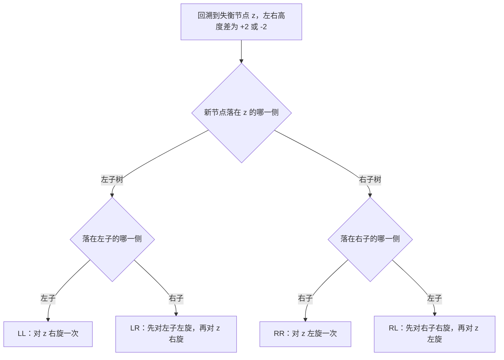

# 平衡树

同样的 $10^6$ 个键，严格平衡的树高不超过 29 层，松一点的不超过 40 层。查找都只比完全平衡多走十到二十次比较。真正拉开差距的是改动之后要修几层。

平衡树就是在 BST 的有序约束上再加一条可检查的不变量。约束越紧，树越矮、查找越快；维持约束的动作越贵。三种主流方案的区别只在选了哪条不变量。

## 一、旋转：不改中序的局部重排

### 1. 单旋只改三个指针

BST 的中序序列是键的全序。任何不改变这个序列的指针重排，都得到同一组键的另一种合法形状。旋转是这类重排里最小的一个。

```text
        y                  x
       / \                / \
      x   T3    右旋→     T1  y
     / \                    / \
    T1  T2                 T2  T3

中序 T1 x T2 y T3：旋转前后逐项相同
```

```python
def rotate_right(y):            # 左子上提为父，中序不变
    x = y.left
    y.left = x.right
    x.right = y
    return x
```

三次指针赋值，没有键的比较与移动，代价 $O(1)$。

### 2. 旋转只把子树压低

右旋之后，以 $x$ 为根的子树高度至多减 1，绝不增加。这个方向性是修复能终止的原因：高度一旦不再变化，祖先就不会新增失衡。

代价也因此上传。子树高度减 1 时，父节点两侧的高度差变了，父节点可能失衡；父节点修复后若高度再减 1，失衡继续向上。修复要走几层，由"这次修复有没有降低高度"决定。

## 二、AVL：把高度差钉在 1

维持不变量有两条路。确定性约束用一条与键无关的形状规则，随机化约束用随机数代替规则。确定性阵营的两个代表是 AVL 树（Adelson-Velsky and Landis Tree，AVL）与红黑树（Red-Black Tree，RBT），两者都用旋转维持约束。

### 1. 不变量与最少节点数

AVL 的约束是：每个节点的左右子树高度差不超过 1。

满足这条约束的树最少有多少节点？设高度为 $h$ 的 AVL 树最少 $N(h)$ 个节点，根的两个子树高度至少是 $h-1$ 与 $h-2$，于是

$$N(h)=N(h-1)+N(h-2)+1,\qquad N(0)=1,\\; N(1)=2$$

这是斐波那契递推，闭式为 $N(h)=F_{h+3}-1$。反解得

$$h<1.44\log_2(n+2)$$

核对前几项： $N(2)=4$、 $N(3)=7$、 $N(4)=12$，与 $F_5-1=4$、 $F_6-1=7$、 $F_7-1=12$ 一致。 $n=10^6$ 时上界约 29 层，比完全平衡的 20 层只多 9 层。

### 2. 插入两次旋转，删除要一路修

插入沿路径回溯，遇到第一个失衡节点就修：单旋或双旋，双旋算两次单旋。修完这棵子树的高度回到插入前，祖先不再失衡，所以插入至多 2 次旋转。

四种失衡按新节点落点分类：



删除不同。删掉一个节点使子树高度减 1，父节点失衡；修好父节点后，这棵子树的高度仍可能比原来少 1，失衡继续上传。最坏情形每一层都要一次旋转，总计 $O(\log n)$ 次。

### 3. 严格换来了什么

严格平衡把树高压到 $1.44\log_2 n$，查找路径在三种方案里最短。代价落在写路径：插入要沿路径回写平衡因子，最坏 $O(\log n)$ 次；删除可能一路修到根。

读密集、写稀少的场景因此适合 AVL。写密集时，删除的修复次数成为主导项。

## 三、红黑树：把高度差放宽到两倍

### 1. 四条不变量与黑高

红黑树的约束有四条：根为黑；叶（空指针所在的 NIL 节点）为黑；红节点的两个子必为黑；任一节点到其后代 NIL 的所有路径上黑节点数相同。最后这个数叫黑高。

红节点不相邻，所以任一路径上红节点数不超过黑节点数，最长路径不超过最短路径的两倍。由黑高反推高度：黑高为 $bh$ 的子树至少有 $2^{bh}-1$ 个内部节点，而 $bh\ge h/2$，于是 $n\ge 2^{h/2}-1$，即

$$h\le 2\log_2(n+1)$$

$n=10^6$ 时上界 40 层。约束松了两倍，换来的是一件事：修复动作从旋转降级为染色。

### 2. 修复次数被常数封顶

插入至多 2 次旋转，其余修复是改颜色；删除至多 3 次旋转，其余也是改颜色。染色只改一个位，不动指针，也不改变任何子树的形状。

这里的关键不是旋转少，而是"旋转次数与 $n$ 无关"。红黑树仍然要沿路径上传，最坏走 $O(\log n)$ 层，但每一层做的是查表与置位，不是三指针重排。

### 3. 工程口径

libstdc++ 的 `std::map`、`std::set` 与 OpenJDK 21 的 `TreeMap` 都用红黑树，标准库不提供 AVL 容器。

原因在写路径的可预测性：红黑树的删除旋转次数有常数上界，AVL 的删除可能一路修到根。库作者选的是最坏写延迟更稳的那一个，不是查找更快的那一个。

## 四、Treap：用随机优先级换掉情形判断

### 1. 两条不变量同时成立

Treap 给每个节点再配一个优先级：键满足 BST 序，优先级满足堆序，即父的优先级大于两个子。优先级在插入时独立均匀抽取。

这样建成的树，与"按键的随机顺序插入"得到的 BST 同分布。同章《树与二叉树》§五.2 给出的结论是随机 BST 的期望高度约 $4.311\ln n$，本文用这条结论直接给 Treap 定界：期望 $O(\log n)$。

### 2. split 与 merge 代替旋转

Treap 不用旋转，用一对沿路径重接指针的操作。

`split(root, key)` 把树分成两棵：键小于 `key` 的与其余的。`merge(L, R)` 在 L 的最大键小于 R 的最小键的前提下，按优先级决定谁当根。

```python
def split(n, key):              # 返回 (l, r)：l 的键 < key ≤ r 的键
    if n is None:
        return None, None
    if key <= n.key:            # n 归右半
        l, r = split(n.left, key)
        n.left = r
        return l, n
    l, r = split(n.right, key)  # n 归左半
    n.right = l
    return n, r
```

插入是 split 加新节点再加一次 merge，删除是两次 split 加一次 merge。每层只重接一个指针，没有"失衡"这个概念，也没有四种情形要判断。

### 3. 退化只是概率事件

树退化成链，要求优先级沿每条路径单调。这样的排列共有 $2^{n-1}$ 种，占全部 $n!$ 种排列的比例是 $2^{n-1}/n!$： $n=20$ 时约 $2\times10^{-13}$。

这是概率保证，不是最坏保证。随机源被预测、或优先级被外部数据带偏时，这个界立刻消失。需要最坏界的地方不能用 Treap 顶替红黑树。

## 五、判据：哪种不变量换哪段路径

| 树 | 不变量 | 界的类型 | 改动时修什么 | 失效条件 |
| --- | --- | --- | --- | --- |
| AVL | 每个节点左右子树高度差不超过 1 | 最坏 | 旋转，删除可能一路修到根 | 写密集：删除的修复层数最多 |
| 红黑树 | 黑高相同、红节点不相邻 | 最坏 | 旋转次数有常数上界，其余是染色 | 要最短查找路径时不如 AVL |
| Treap | 键满足 BST 序，优先级满足堆序 | 期望 | 只重接指针，无情形判断 | 随机源可预测时失去保证 |

三条判据把表压成选择：

读多写少，取 AVL，它的树高在三种方案里最小。写多或做通用容器，取红黑树，它的删除旋转次数与 $n$ 无关。需要 split/merge、或想避开情形判断，取 Treap，代价是界从最坏变成期望。

三种不变量换的是同一件事：把修复限制在改动路径上。旋转把单次修复的代价压到三个指针，剩下的差别只在修几层、以及这个层数是最坏界还是期望界。
